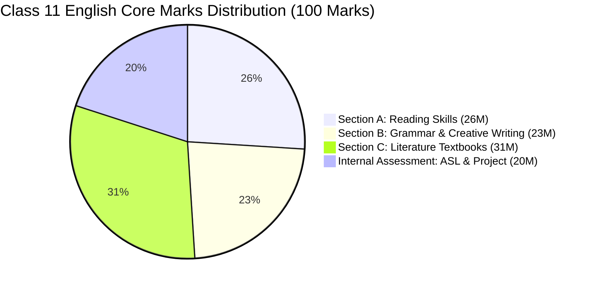

# Class 11 English Core (Code: 301) — Annual Curriculum Architecture (2026-27)

> **Directorate of Education, GNCT Delhi & CBSE Senior Secondary**  
> **Course:** Class 11 English Core (`Code: 301`)  
> **Academic Session:** 2026-27  
> **Evaluation Scheme:** 80 Marks (Theory Paper / 3 Hours) + 20 Marks (Internal Assessment / ASL & Project Work) = **100 Marks**  
> **Database Architecture:** Exam Type ID `303d9917-55e9-4f81-8a0f-129ba4c01aef` | Subject ID `65d29b56-0301-0000-0000-000000000011`

---

## Examination Blueprint & Marks Distribution

### Term-Wise Syllabus Schedule (Delhi DoE Guidelines)
- **Mid-Term Examination (Target Completion: September 05, 2026):**
  - **Hornbill:** Lessons 1, 2, 3; Poems 1, 2.
  - **Snapshots:** Lessons 1, 2, 3.
  - **Reading Skills:** Unseen Passages (Factual/Descriptive/Case-based), Note-Making & Summarization.
  - **Writing Skills:** Classified Advertisements, Poster Making, Speech Writing, Debate Writing.
  - **Grammar:** Tenses, Clauses, Sentence Reordering, Transformation of Sentences.
  - **Internal Assessment:** Assessment of Listening (5M) + Assessment of Speaking (5M) + Project Work (10M).
- **Annual Examination (Full Syllabus Completion: January 30, 2027):**
  - **Hornbill (Remaining):** Lessons 4, 5; Poems 3, 4, 5.
  - **Snapshots (Remaining):** Lessons 4, 5.
  - Full syllabus revision & summative assessment across all sections.

---

## Detailed Sectional Structure

### Section A: Reading Skills (26 Marks)
1. **Unseen Passage (Factual, Descriptive or Literary):** 10 Marks (10 multiple choice / objective / short answer questions to assess comprehension, interpretation, analysis, inference, and vocabulary).
2. **Unseen Case-Based Factual Passage:** 8 Marks (with verbal/visual inputs like statistical data, charts, infographics. Combined word limit for passages 1 & 2: 600-750 words).
3. **Note-Making & Summarization:** 8 Marks (Passage: 200-250 words; Notes: Title, Numbering, Indenting, Key/Abbreviations = 5 Marks; Summary up to 50 words = 3 Marks).

### Section B: Grammar & Creative Writing Skills (23 Marks)
- **Grammar (7 Marks):**
  - Gap filling (Tenses & Clauses) — 4 Marks
  - Sentence Reordering / Transformation of Sentences — 3 Marks
- **Creative Writing Skills (16 Marks):**
  - Short Writing Task: **Classified Advertisements** (up to 50 words) — 3 Marks
  - Short Writing Task: **Poster Making** (up to 50 words) — 3 Marks
  - Long Writing Task: **Speech Writing** (120-150 words) — 5 Marks
  - Long Writing Task: **Debate Writing** (120-150 words) — 5 Marks

### Section C: Literature Textbooks & Supplementary Reading Text (31 Marks)
- **Hornbill (Prose & Poetry):** 18 Marks
- **Snapshots (Supplementary Stories):** 13 Marks

### Internal Assessment (20 Marks)
- **Assessment of Listening Skills (ALS):** 5 Marks
- **Assessment of Speaking Skills (ASS):** 5 Marks
- **Project Work & Viva-Voce:** 10 Marks

---

## Chapters Breakdown & Curriculum Architecture (26 Chapters)

| Ch # | Chapter Title | Chapter ID | Section & Domain | Status |
|:---:|---|---|---|:---:|
| **Ch 1** | Hornbill: The Portrait of a Lady | `65d29b56-0301-1100-0000-000000000001` | Section C: Hornbill Prose | `NoK4h6ovI-A` (Magnet Brains) \| ✅ Verified (0s ➔ 2796s) |
| **Ch 2** | Hornbill: We're Not Afraid to Die... If We Can All Be Together | `65d29b56-0301-1100-0000-000000000002` | Section C: Hornbill Prose | `lrUa6TRGL44` (Magnet Brains) \| ✅ Verified (0s ➔ 6192s) |
| **Ch 3** | Hornbill: Discovering Tut: The Saga Continues | `65d29b56-0301-1100-0000-000000000003` | Section C: Hornbill Prose | ⏳ Scaffolded |
| **Ch 4** | Hornbill: The Adventure | `65d29b56-0301-1100-0000-000000000004` | Section C: Hornbill Prose | ⏳ Scaffolded |
| **Ch 5** | Hornbill: Silk Road | `65d29b56-0301-1100-0000-000000000005` | Section C: Hornbill Prose | ⏳ Scaffolded |
| **Ch 6** | Hornbill Poem: A Photograph | `65d29b56-0301-1100-0000-000000000006` | Section C: Hornbill Poetry | ⏳ Scaffolded |
| **Ch 7** | Hornbill Poem: The Laburnum Top | `65d29b56-0301-1100-0000-000000000007` | Section C: Hornbill Poetry | ⏳ Scaffolded |
| **Ch 8** | Hornbill Poem: The Voice of the Rain | `65d29b56-0301-1100-0000-000000000008` | Section C: Hornbill Poetry | ⏳ Scaffolded |
| **Ch 9** | Hornbill Poem: Childhood | `65d29b56-0301-1100-0000-000000000009` | Section C: Hornbill Poetry | ⏳ Scaffolded |
| **Ch 10** | Hornbill Poem: Father to Son | `65d29b56-0301-1100-0000-000000000010` | Section C: Hornbill Poetry | ⏳ Scaffolded |
| **Ch 11** | Snapshots: The Summer of the Beautiful White Horse | `65d29b56-0301-1100-0000-000000000011` | Section C: Snapshots Supplementary | ⏳ Scaffolded |
| **Ch 12** | Snapshots: The Address | `65d29b56-0301-1100-0000-000000000012` | Section C: Snapshots Supplementary | ⏳ Scaffolded |
| **Ch 13** | Snapshots: Mother's Day | `65d29b56-0301-1100-0000-000000000013` | Section C: Snapshots Supplementary | ⏳ Scaffolded |
| **Ch 14** | Snapshots: Birth | `65d29b56-0301-1100-0000-000000000014` | Section C: Snapshots Supplementary | ⏳ Scaffolded |
| **Ch 15** | Snapshots: The Tale of Melon City | `65d29b56-0301-1100-0000-000000000015` | Section C: Snapshots Supplementary | ⏳ Scaffolded |
| **Ch 16** | Grammar: Tenses & Gap Filling | `65d29b56-0301-1100-0000-000000000016` | Section B: Applied Grammar | ⏳ Scaffolded |
| **Ch 17** | Grammar: Clauses (Noun, Adverbial & Relative Clauses) | `65d29b56-0301-1100-0000-000000000017` | Section B: Applied Grammar | ⏳ Scaffolded |
| **Ch 18** | Grammar: Sentence Reordering & Transformation of Sentences | `65d29b56-0301-1100-0000-000000000018` | Section B: Applied Grammar | ⏳ Scaffolded |
| **Ch 19** | Writing Skills: Classified Advertisements | `65d29b56-0301-1100-0000-000000000019` | Section B: Creative Writing | ⏳ Scaffolded |
| **Ch 20** | Writing Skills: Poster Making | `65d29b56-0301-1100-0000-000000000020` | Section B: Creative Writing | ⏳ Scaffolded |
| **Ch 21** | Writing Skills: Speech Writing | `65d29b56-0301-1100-0000-000000000021` | Section B: Creative Writing | ⏳ Scaffolded |
| **Ch 22** | Writing Skills: Debate Writing | `65d29b56-0301-1100-0000-000000000022` | Section B: Creative Writing | ⏳ Scaffolded |
| **Ch 23** | Reading Skills: Unseen Passages (Factual, Descriptive & Literary) | `65d29b56-0301-1100-0000-000000000023` | Section A: Reading Skills | ⏳ Scaffolded |
| **Ch 24** | Reading Skills: Case-Based Factual Passages (Charts & Data) | `65d29b56-0301-1100-0000-000000000024` | Section A: Reading Skills | ⏳ Scaffolded |
| **Ch 25** | Reading Skills: Note-Making and Summarization | `65d29b56-0301-1100-0000-000000000025` | Section A: Reading Skills | ⏳ Scaffolded |
| **Ch 26** | Internal Assessment: ASL (Listening & Speaking) & Project Work | `65d29b56-0301-1100-0000-000000000026` | Internal Assessment (20M) | ⏳ Scaffolded |
| **TOTAL** | **Class 11 English Core (301)** | | **Full Official Delhi DoE / CBSE Senior Secondary Architecture** | **2/26 Chapters Fully Seeded** |

---

## Chapter Lecture Blueprints & Continuous Timelines

### Chapter 1: Hornbill: The Portrait of a Lady
- **Chapter ID:** `65d29b56-0301-1100-0000-000000000001`
- **Video:** Magnet Brains (`NoK4h6ovI-A`) | English Core Class 11 | Total Duration: 2796s (46m 36s, Full Lecture & Visual Mind Map)
1. `65d29b56-0301-2101-0000-000000000001`: Author Introduction, Background & Phase 1: Village Life & Friendship with Grandmother (`0s` ➔ `1070s`)
2. `65d29b56-0301-2101-0000-000000000002`: The Turning Point: Phase 2 (City School Life), Phase 3 (University), Going Abroad & Homecoming (`1070s` ➔ `2160s`)
3. `65d29b56-0301-2101-0000-000000000003`: Grandmother's Final Hours, Mourning of the Sparrows & Comprehensive Visual Mind Map Summary (`2160s` ➔ `2796s`)

### Chapter 2: Hornbill: We're Not Afraid to Die... If We Can All Be Together
- **Chapter ID:** `65d29b56-0301-1100-0000-000000000002`
- **Video:** Magnet Brains (`lrUa6TRGL44`) | English Core Class 11 | Total Duration: 6192s (1h 43m 12s, Outro trimmed)
1. `65d29b56-0301-2102-0000-000000000001`: Voyage Planning, Wavewalker Architecture & Smooth Passage to Cape Town (`0s` ➔ `1650s`)
2. `65d29b56-0301-2102-0000-000000000002`: Gigantic Waves, Catastrophic Strike & The Desperate Fight for Survival (`1650s` ➔ `3750s`)
3. `65d29b56-0301-2102-0000-000000000003`: Pinpricks in the Ocean, Suzanne's Bravery & Jonathan's Defining Courage (`3750s` ➔ `5250s`)
4. `65d29b56-0301-2102-0000-000000000004`: Course 185°, Sighting Île Amsterdam & Tributes of Heroism and Survival (`5250s` ➔ `6192s`)

