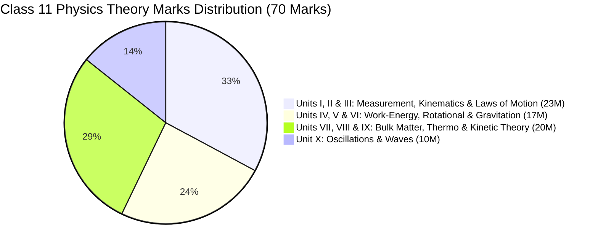

# Class 11 Physics (Code: 042 / 42) — Annual Curriculum Architecture (2026-27)

> **Directorate of Education, GNCT Delhi & CBSE Senior Secondary**  
> **Course:** Class 11 Physics (`Code: 042` / `CODE-42`)  
> **Academic Session:** 2026-27  
> **Evaluation Scheme:** 70 Marks (Theory Paper / 3 Hours) + 30 Marks (Practicals / Internal Evaluation) = **100 Marks**  
> **Database Architecture:** Exam Type ID `303d9917-55e9-4f81-8a0f-129ba4c01aef` | Subject ID `65d29b56-0420-0000-0000-000000000011`  
> **Status:** **14/14 CHAPTERS (100% COMPLETE)** — All 59 continuous subtopics seeded in remote Supabase DB via Flyway migrations `V197` to `V211`.

---

## Examination Blueprint & Marks Distribution

### Term-Wise Syllabus Schedule (Delhi DoE Guidelines)
- **Mid-Term Examination (Target Completion: September 05, 2026) — 40 Marks:**
  - **Unit I:** Chapter 1: Units and Measurements (5 Subtopics)
  - **Unit II:** Chapter 2: Motion in a Straight Line (5 Subtopics), Chapter 3: Motion in a Plane (4 Subtopics)
  - **Unit III:** Chapter 4: Laws of Motion (4 Subtopics)
  - **Unit IV:** Chapter 5: Work, Energy and Power (4 Subtopics)
  - **Unit V:** Chapter 6: System of Particles and Rotational Motion (4 Subtopics)
  - **Unit VI:** Chapter 7: Gravitation (4 Subtopics)
  - *Mid-Term Exam 2026 + Question Paper Analysis & Revision.*
- **Annual Examination (Full Syllabus Completion: January 30, 2027) — 30 Marks Post-Midterm (Total 70M):**
  - **Unit VII:** Chapter 8: Mechanical Properties of Solids (4 Subtopics), Chapter 9: Mechanical Properties of Fluids (5 Subtopics), Chapter 10: Thermal Properties of Matter (4 Subtopics)
  - **Unit VIII:** Chapter 11: Thermodynamics (4 Subtopics)
  - **Unit IX:** Chapter 12: Kinetic Theory (4 Subtopics)
  - **Unit X:** Chapter 13: Oscillations (4 Subtopics), Chapter 14: Waves (4 Subtopics)
  - *Revision from Support Material & Practice Papers uploaded on MIS.*

---

## Course Structure & Unit Breakdown

| Unit # | Unit Name | Chapters Included | CBSE Marks |
|:---:|---|---|:---:|
| **Unit I** | Physical World and Measurement | Chapter 1: Units and Measurements | \multirow{3}{*}{**23 Marks**} |
| **Unit II** | Kinematics | Chapter 2: Motion in a Straight Line Chapter 3: Motion in a Plane | |
| **Unit III** | Laws of Motion | Chapter 4: Laws of Motion | |
| **Unit IV** | Work, Energy and Power | Chapter 5: Work, Energy and Power | \multirow{3}{*}{**17 Marks**} |
| **Unit V** | Motion of System of Particles and Rigid Body | Chapter 6: System of Particles and Rotational Motion | |
| **Unit VI** | Gravitation | Chapter 7: Gravitation | |
| **Unit VII** | Properties of Bulk Matter | Chapter 8: Mechanical Properties of Solids Chapter 9: Mechanical Properties of Fluids Chapter 10: Thermal Properties of Matter | \multirow{3}{*}{**20 Marks**} |
| **Unit VIII**| Thermodynamics | Chapter 11: Thermodynamics | |
| **Unit IX** | Behaviour of Perfect Gases and Kinetic Theory | Chapter 12: Kinetic Theory | |
| **Unit X** | Oscillations and Waves | Chapter 13: Oscillations Chapter 14: Waves | **10 Marks** |
| **TOTAL** | **Theory Course (3 Hours)** | **14 Chapters (10 Units, 59 Subtopics)** | **70 Marks** |

---

## Master Chapters Directory & Migration Status (14/14 Complete)

| Ch # | Chapter Title | Chapter ID | Masterclass Video & Educator | Views | Subtopics | Cutoff Timestamp | Flyway Migration |
|:---:|---|---|---|:---:|:---:|:---:|:---:|
| **Ch 1** | Units and Measurements | `65d29b56-0420-1100-0000-000000000001` | PW Class 11 Science - Akshay Tyagi Sir (`5rm-iI9Nqyo`) | 945K | 5 Subtopics | `8110s` (02:15:10) | `V198` |
| **Ch 2** | Motion in a Straight Line | `65d29b56-0420-1100-0000-000000000002` | PW Class 11 Science - Akshay Tyagi Sir (`Tf_NDFEPiEQ`) | 1.57M | 5 Subtopics | `9340s` (02:35:40) | `V199` |
| **Ch 3** | Motion in a Plane | `65d29b56-0420-1100-0000-000000000003` | PW Class 11 Science - Akshay Tyagi Sir (`Rguy27cyJpo`) | 655K | 4 Subtopics | `12480s` (03:28:00) | `V200` |
| **Ch 4** | Laws of Motion | `65d29b56-0420-1100-0000-000000000004` | LearnoHub - Roshni Mukherjee (`sD2Bbz6a--c`) | 418K | 4 Subtopics | `9280s` (02:34:40) | `V201` |
| **Ch 5** | Work, Energy and Power | `65d29b56-0420-1100-0000-000000000005` | LearnoHub - Roshni Mukherjee (`oswh0W7uMGo`) | 366K | 4 Subtopics | `5820s` (01:37:00) | `V202` |
| **Ch 6** | System of Particles and Rotational Motion | `65d29b56-0420-1100-0000-000000000006` | LearnoHub - Roshni Mukherjee (`gIDn8NW3N6M`) | 384K | 4 Subtopics | `8750s` (02:25:50) | `V203` |
| **Ch 7** | Gravitation | `65d29b56-0420-1100-0000-000000000007` | LearnoHub - Roshni Mukherjee (`1FY5JGkhMkE`) | 271K | 4 Subtopics | `6690s` (01:51:30) | `V204` |
| **Ch 8** | Mechanical Properties of Solids | `65d29b56-0420-1100-0000-000000000008` | LearnoHub - Roshni Mukherjee (`p4zl6OBD80o`) | 134K | 4 Subtopics | `5080s` (01:24:40) | `V205` |
| **Ch 9** | Mechanical Properties of Fluids | `65d29b56-0420-1100-0000-000000000009` | Prashant Kirad Class 11 (`R8gN-kDi5E8`) | 2.59M | 5 Subtopics | `9950s` (02:45:50) | `V206` |
| **Ch 10** | Thermal Properties of Matter | `65d29b56-0420-1100-0000-000000000010` | LearnoHub - Roshni Mukherjee (`JVhYUndMXCE`) | 68K | 4 Subtopics | `9600s` (02:40:00) | `V207` |
| **Ch 11** | Thermodynamics | `65d29b56-0420-1100-0000-000000000011` | LearnoHub - Roshni Mukherjee (`qRNUZQlxXU0`) | 134K | 4 Subtopics | `7820s` (02:10:20) | `V208` |
| **Ch 12** | Kinetic Theory | `65d29b56-0420-1100-0000-000000000012` | Next Toppers CBSE 2026-27 (`QokEth-VtKc`) | 173K | 4 Subtopics | `7260s` (02:01:00) | `V209` |
| **Ch 13** | Oscillations | `65d29b56-0420-1100-0000-000000000013` | NCERT Wallah - Physics Wallah (`eL7s6QvvY7k`) | 212K | 4 Subtopics | `8125s` (02:15:25) | `V210` |
| **Ch 14** | Waves | `65d29b56-0420-1100-0000-000000000014` | PW Class 11 Science (`p3vMfyGjfcM`) | 906K | 4 Subtopics | `8640s` (02:24:00) | `V211` |
| **TOTAL** | **Class 11 Physics (042)** | | **14 Official CBSE / Delhi DoE Chapters** | | **59 Subtopics** | **Zero-Gap Timelines** | **V197–V211 (Active)** |

---

## Detailed Chapter Subtopic Breakdowns

### Chapter 1: Units and Measurements
- **Masterclass Video:** PW Class 11 Science - Akshay Tyagi Sir (`5rm-iI9Nqyo`)
- **Total Teaching Duration:** `8110s` (02:15:10, Outro banter trimmed)
- **Subtopics:**
  1. `0s` ➔ `2354s` (39m 14s): Physical Quantities, Systems of Units & SI Standards
  2. `2354s` ➔ `3586s` (20m 32s): Dimensions & Dimensional Formulae of Physical Quantities
  3. `3586s` ➔ `5590s` (33m 24s): Applications of Dimensional Analysis (Homogeneity, Checking Equations & Deriving Relations)
  4. `5590s` ➔ `7105s` (25m 15s): Significant Figures, Uncertainty & Rounding Off in Calculations
  5. `7105s` ➔ `8110s` (16m 45s): NCERT Board Practice Questions & Limitations of Dimensional Analysis

### Chapter 2: Motion in a Straight Line
- **Masterclass Video:** PW Class 11 Science - Akshay Tyagi Sir (`Tf_NDFEPiEQ`)
- **Total Teaching Duration:** `9340s` (02:35:40, Outro banter trimmed)
- **Subtopics:**
  1. `0s` ➔ `2020s` (33m 40s): Frame of Reference, Rest & Motion, Distance vs Displacement
  2. `2020s` ➔ `5899s` (64m 39s): Speed, Velocity & Instantaneous Kinematics (Calculus Method)
  3. `5899s` ➔ `7803s` (31m 44s): Kinematic Equations of Motion, Free Fall & Galileo's Law
  4. `7803s` ➔ `8685s` (14m 42s): Graphical Analysis of Motion (Position-Time & Velocity-Time Graphs)
  5. `8685s` ➔ `9340s` (10m 55s): Derivations of Equations of Motion (Calculus & Graphical Treatments)

### Chapter 3: Motion in a Plane
- **Masterclass Video:** PW Class 11 Science - Akshay Tyagi Sir (`Rguy27cyJpo`)
- **Total Teaching Duration:** `12480s` (03:28:00, Outro trimmed)
- **Subtopics:**
  1. `0s` ➔ `2697s` (44m 57s): Vectors, Representation & Resolution into Rectangular Components
  2. `2697s` ➔ `6762s` (67m 45s): Vector Algebra (Addition, Subtraction, Dot Product & Cross Product)
  3. `6762s` ➔ `9946s` (53m 04s): Projectile Motion (Trajectory Equation, Time of Flight, Range & Max Height)
  4. `9946s` ➔ `12480s` (42m 14s): Uniform & Non-Uniform Circular Motion (Centripetal Acceleration & Numericals)

### Chapter 4: Laws of Motion
- **Masterclass Video:** LearnoHub - Roshni Mukherjee (`sD2Bbz6a--c`)
- **Total Teaching Duration:** `9280s` (02:34:40, Outro marketing trimmed)
- **Subtopics:**
  1. `0s` ➔ `2186s` (36m 26s): Intuitive Concept of Force, Inertia, Newton's 1st & 2nd Laws, Momentum & Impulse
  2. `2186s` ➔ `3678s` (24m 52s): Newton's 3rd Law, Conservation of Linear Momentum & Equilibrium of Concurrent Forces
  3. `3678s` ➔ `7991s` (71m 53s): Friction: Static, Kinetic, Rolling Friction & Lubrication
  4. `7991s` ➔ `9280s` (21m 29s): Dynamics of Uniform Circular Motion: Centripetal Force & Banking of Roads

### Chapter 5: Work, Energy and Power
- **Masterclass Video:** LearnoHub - Roshni Mukherjee (`oswh0W7uMGo`)
- **Total Teaching Duration:** `5820s` (01:37:00, Outro marketing trimmed)
- **Subtopics:**
  1. `0s` ➔ `1699s` (28m 19s): Work Done by Constant & Variable Force, Scalar Product & Kinetic Energy
  2. `1699s` ➔ `3728s` (33m 49s): Work-Energy Theorem & Potential Energy (Gravitational & Spring Potential Energy)
  3. `3728s` ➔ `4413s` (11m 25s): Power (Average & Instantaneous) & Vertical Circular Motion
  4. `4413s` ➔ `5820s` (23m 27s): Collisions in One and Two Dimensions (Elastic & Inelastic Collisions)

### Chapter 6: System of Particles and Rotational Motion
- **Masterclass Video:** LearnoHub - Roshni Mukherjee (`gIDn8NW3N6M`)
- **Total Teaching Duration:** `8750s` (02:25:50, Outro marketing trimmed)
- **Subtopics:**
  1. `0s` ➔ `2752s` (45m 52s): Centre of Mass, Motion of CM & Momentum Conservation of System of Particles
  2. `2752s` ➔ `5084s` (38m 52s): Vector Product, Torque & Angular Momentum (Dynamics of Rotation)
  3. `5084s` ➔ `6541s` (24m 17s): Equilibrium of Rigid Bodies, Couple, Principle of Moments & Centre of Gravity
  4. `6541s` ➔ `8750s` (36m 49s): Moment of Inertia, Rotational Kinematics & Rolling Motion Dynamics

### Chapter 7: Gravitation
- **Masterclass Video:** LearnoHub - Roshni Mukherjee (`1FY5JGkhMkE`)
- **Total Teaching Duration:** `6690s` (01:51:30, Outro marketing trimmed)
- **Subtopics:**
  1. `0s` ➔ `2108s` (35m 08s): Kepler's Laws of Planetary Motion & Universal Law of Gravitation
  2. `2108s` ➔ `3551s` (24m 03s): Acceleration Due to Gravity (g) & Its Variation with Altitude and Depth
  3. `3551s` ➔ `5020s` (24m 29s): Gravitational Potential Energy & Gravitational Potential
  4. `5020s` ➔ `6690s` (27m 50s): Escape Speed, Satellite Orbital Motion & Energy of Orbiting Satellite

### Chapter 8: Mechanical Properties of Solids
- **Masterclass Video:** LearnoHub - Roshni Mukherjee (`p4zl6OBD80o`)
- **Total Teaching Duration:** `5080s` (01:24:40, Outro marketing trimmed)
- **Subtopics:**
  1. `0s` ➔ `1222s` (20m 22s): Elasticity, Stress & Strain, and Hooke's Law
  2. `1222s` ➔ `2657s` (23m 55s): Stress-Strain Curve & Young's Modulus of Elasticity
  3. `2657s` ➔ `3990s` (22m 13s): Shear Modulus, Bulk Modulus, Compressibility & Poisson's Ratio
  4. `3990s` ➔ `5080s` (18m 10s): Elastic Potential Energy of Stretched Wire & Applications of Elasticity

### Chapter 9: Mechanical Properties of Fluids
- **Masterclass Video:** Prashant Kirad Class 11 Science (`R8gN-kDi5E8`)
- **Total Teaching Duration:** `9950s` (02:45:50, Outro trimmed)
- **Subtopics:**
  1. `0s` ➔ `2748s` (45m 48s): Fluid Pressure, Variation of Pressure with Depth & Barometer Measurement
  2. `2748s` ➔ `4243s` (24m 55s): Pascal's Law (Hydraulic Lift & Brakes) & Archimedes' Principle
  3. `4243s` ➔ `6169s` (32m 06s): Fluid Dynamics: Continuity Equation, Bernoulli's Theorem & Applications
  4. `6169s` ➔ `7777s` (26m 48s): Viscosity, Stokes' Law & Terminal Velocity in Viscous Fluids
  5. `7777s` ➔ `9950s` (36m 13s): Surface Tension, Excess Pressure in Drops/Bubbles & Capillarity

### Chapter 10: Thermal Properties of Matter
- **Masterclass Video:** LearnoHub - Roshni Mukherjee (`JVhYUndMXCE`)
- **Total Teaching Duration:** `9600s` (02:40:00, Outro marketing trimmed)
- **Subtopics:**
  1. `0s` ➔ `2858s` (47m 38s): Heat, Temperature & Thermal Expansion (Solids, Liquids & Gases)
  2. `2858s` ➔ `5168s` (38m 30s): Specific Heat Capacity, Calorimetry & Latent Heat (Change of State)
  3. `5168s` ➔ `7695s` (42m 07s): Modes of Heat Transfer: Conduction, Convection & Radiation
  4. `7695s` ➔ `9600s` (31m 45s): Blackbody Radiation, Wien's Displacement Law & Stefan-Boltzmann Law

### Chapter 11: Thermodynamics
- **Masterclass Video:** LearnoHub - Roshni Mukherjee (`qRNUZQlxXU0`)
- **Total Teaching Duration:** `7820s` (02:10:20, Outro marketing trimmed)
- **Subtopics:**
  1. `0s` ➔ `1496s` (24m 56s): Thermal Equilibrium, Zeroth Law & Internal Energy
  2. `1496s` ➔ `3339s` (30m 43s): First Law of Thermodynamics & Molar Specific Heat Capacities (Cp & Cv)
  3. `3339s` ➔ `5582s` (37m 23s): Thermodynamic Processes: Isothermal, Adiabatic, Isochoric, Isobaric & Cyclic
  4. `5582s` ➔ `7820s` (37m 18s): Second Law of Thermodynamics, Reversible/Irreversible Processes & Heat Engines

### Chapter 12: Kinetic Theory
- **Masterclass Video:** Next Toppers CBSE 2026-27 (`QokEth-VtKc`)
- **Total Teaching Duration:** `7260s` (02:01:00, Outro trimmed)
- **Subtopics:**
  1. `0s` ➔ `2359s` (39m 19s): Equation of State of Ideal Gas & Assumptions of Kinetic Theory
  2. `2359s` ➔ `4617s` (37m 38s): Pressure of an Ideal Gas, Kinetic Temperature & RMS Molecular Speed
  3. `4617s` ➔ `6103s` (24m 46s): Degrees of Freedom, Law of Equipartition of Energy & Specific Heats of Gases
  4. `6103s` ➔ `7260s` (19m 17s): Mean Free Path, Avogadro's Number & NCERT Board Numerical Practice

### Chapter 13: Oscillations
- **Masterclass Video:** NCERT Wallah - Physics Wallah (`eL7s6QvvY7k`)
- **Total Teaching Duration:** `8125s` (02:15:25, Outro banter trimmed)
- **Subtopics:**
  1. `0s` ➔ `2196s` (36m 36s): Periodic & Oscillatory Motion, Periodic Functions & Harmonic Motion
  2. `2196s` ➔ `5040s` (47m 24s): Simple Harmonic Motion (SHM), Uniform Circular Motion & Phase Relations
  3. `5040s` ➔ `6956s` (31m 56s): Energy in SHM (Kinetic, Potential & Total Energy) & Loaded Spring Oscillations
  4. `6956s` ➔ `8125s` (19m 29s): Simple Pendulum: Derivation of Time Period & Board Numerical Practice

### Chapter 14: Waves
- **Masterclass Video:** PW Class 11 Science (`p3vMfyGjfcM`)
- **Total Teaching Duration:** `8640s` (02:24:00, Outro banter trimmed)
- **Subtopics:**
  1. `0s` ➔ `1824s` (30m 24s): Wave Motion, Transverse vs Longitudinal Waves & Wave Characteristics
  2. `1824s` ➔ `4120s` (38m 16s): Progressive Waves: Displacement Equation, Phase Difference & Particle Velocity
  3. `4120s` ➔ `5808s` (28m 08s): Speed of Travelling Waves (Strings & Sound in Gases) & Laplace Correction
  4. `5808s` ➔ `8640s` (47m 12s): Superposition, Standing Waves in Strings/Organ Pipes & Beats
