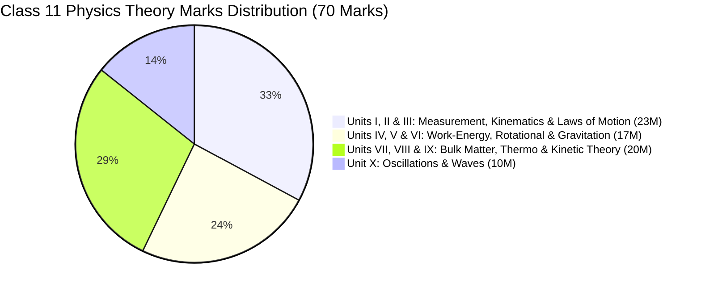

# Class 11 Physics (Code: 042 / 42) — Annual Curriculum Architecture (2026-27)

> **Directorate of Education, GNCT Delhi & CBSE Senior Secondary**  
> **Course:** Class 11 Physics (`Code: 042` / `CODE-42`)  
> **Academic Session:** 2026-27  
> **Evaluation Scheme:** 70 Marks (Theory Paper / 3 Hours) + 30 Marks (Practicals / Internal Evaluation) = **100 Marks**  
> **Database Architecture:** Exam Type ID `303d9917-55e9-4f81-8a0f-129ba4c01aef` | Subject ID `65d29b56-0420-0000-0000-000000000011`

---

## Examination Blueprint & Marks Distribution

### Term-Wise Syllabus Schedule (Delhi DoE Guidelines)
- **Mid-Term Examination (Target Completion: September 05, 2026) — 40 Marks:**
  - **Unit I:** Chapter 1: Units and Measurements
  - **Unit II:** Chapter 2: Motion in a Straight Line, Chapter 3: Motion in a Plane
  - **Unit III:** Chapter 4: Laws of Motion
  - **Unit IV:** Chapter 5: Work, Energy and Power
  - **Unit V:** Chapter 6: System of Particles and Rotational Motion
  - **Unit VI:** Chapter 7: Gravitation
  - *Mid-Term Exam 2026 + Question Paper Analysis & Revision.*
- **Annual Examination (Full Syllabus Completion: January 30, 2027) — 30 Marks Post-Midterm (Total 70M):**
  - **Unit VII:** Chapter 8: Mechanical Properties of Solids, Chapter 9: Mechanical Properties of Fluids, Chapter 10: Thermal Properties of Matter
  - **Unit VIII:** Chapter 11: Thermodynamics
  - **Unit IX:** Chapter 12: Kinetic Theory
  - **Unit X:** Chapter 13: Oscillations, Chapter 14: Waves
  - *Revision from Support Material & Practice Papers uploaded on MIS.*

---

## Course Structure & Unit Breakdown

| Unit # | Unit Name | Chapters Included | CBSE Marks |
|:---:|---|---|:---:|
| **Unit I** | Physical World and Measurement | Chapter 1: Units and Measurements | \multirow{3}{*}{**23 Marks**} |
| **Unit II** | Kinematics | Chapter 2: Motion in a Straight Line Chapter 3: Motion in a Plane | |
| **Unit III** | Laws of Motion | Chapter 4: Laws of Motion | |
| **Unit IV** | Work, Energy and Power | Chapter 5: Work, Energy and Power | \multirow{3}{*}{**17 Marks**} |
| **Unit V** | Motion of System of Particles and Rigid Body | Chapter 6: System of Particles and Rotational Motion | |
| **Unit VI** | Gravitation | Chapter 7: Gravitation | |
| **Unit VII** | Properties of Bulk Matter | Chapter 8: Mechanical Properties of Solids Chapter 9: Mechanical Properties of Fluids Chapter 10: Thermal Properties of Matter | \multirow{3}{*}{**20 Marks**} |
| **Unit VIII**| Thermodynamics | Chapter 11: Thermodynamics | |
| **Unit IX** | Behaviour of Perfect Gases and Kinetic Theory | Chapter 12: Kinetic Theory | |
| **Unit X** | Oscillations and Waves | Chapter 13: Oscillations Chapter 14: Waves | **10 Marks** |
| **TOTAL** | **Theory Course (3 Hours)** | **14 Chapters (10 Units)** | **70 Marks** |

---

## Chapters Breakdown & Database Architecture (14 Chapters)

| Ch # | Chapter Title | Chapter ID | Unit & Term | Status |
|:---:|---|---|---|:---:|
| **Ch 1** | Units and Measurements | `65d29b56-0420-1100-0000-000000000001` | Unit I: Physical World & Measurement (Mid-Term) | ⏳ Scaffolded |
| **Ch 2** | Motion in a Straight Line | `65d29b56-0420-1100-0000-000000000002` | Unit II: Kinematics (Mid-Term) | ⏳ Scaffolded |
| **Ch 3** | Motion in a Plane | `65d29b56-0420-1100-0000-000000000003` | Unit II: Kinematics (Mid-Term) | ⏳ Scaffolded |
| **Ch 4** | Laws of Motion | `65d29b56-0420-1100-0000-000000000004` | Unit III: Laws of Motion (Mid-Term) | ⏳ Scaffolded |
| **Ch 5** | Work, Energy and Power | `65d29b56-0420-1100-0000-000000000005` | Unit IV: Work, Energy and Power (Mid-Term) | ⏳ Scaffolded |
| **Ch 6** | System of Particles and Rotational Motion | `65d29b56-0420-1100-0000-000000000006` | Unit V: Rotational Motion (Mid-Term) | ⏳ Scaffolded |
| **Ch 7** | Gravitation | `65d29b56-0420-1100-0000-000000000007` | Unit VI: Gravitation (Mid-Term) | ⏳ Scaffolded |
| **Ch 8** | Mechanical Properties of Solids | `65d29b56-0420-1100-0000-000000000008` | Unit VII: Properties of Bulk Matter (Annual) | ⏳ Scaffolded |
| **Ch 9** | Mechanical Properties of Fluids | `65d29b56-0420-1100-0000-000000000009` | Unit VII: Properties of Bulk Matter (Annual) | ⏳ Scaffolded |
| **Ch 10** | Thermal Properties of Matter | `65d29b56-0420-1100-0000-000000000010` | Unit VII: Properties of Bulk Matter (Annual) | ⏳ Scaffolded |
| **Ch 11** | Thermodynamics | `65d29b56-0420-1100-0000-000000000011` | Unit VIII: Thermodynamics (Annual) | ⏳ Scaffolded |
| **Ch 12** | Kinetic Theory | `65d29b56-0420-1100-0000-000000000012` | Unit IX: Behaviour of Perfect Gases (Annual) | ⏳ Scaffolded |
| **Ch 13** | Oscillations | `65d29b56-0420-1100-0000-000000000013` | Unit X: Oscillations & Waves (Annual) | ⏳ Scaffolded |
| **Ch 14** | Waves | `65d29b56-0420-1100-0000-000000000014` | Unit X: Oscillations & Waves (Annual) | ⏳ Scaffolded |
| **TOTAL** | **Class 11 Physics (042)** | | **Full Official Delhi DoE / CBSE Senior Secondary Architecture** | **14 Chapters Scaffolded (Ready for Curation)** |

---

## Detailed Syllabus Topics per Chapter (Official CBSE / DoE Guidelines)

### Chapter 1: Units and Measurements
- **Need for measurement:** Units of measurement; systems of units; SI units, fundamental and derived units.
- **Significant figures:** Rules of significant figures, determining the uncertainty in results.
- **Dimensional Analysis:** Dimensions of physical quantities, dimensional formulae, dimensional equations and its applications (checking correctness, deriving relations, conversion between systems).

### Chapter 2: Motion in a Straight Line
- **Frame of reference:** Motion in a straight line, position, distance, and displacement.
- **Calculus Concepts:** Elementary concepts of differentiation and integration for describing motion.
- **Kinematic Variables:** Uniform and non-uniform motion, average speed, average velocity, instantaneous velocity, instantaneous acceleration.
- **Uniformly Accelerated Motion:** Velocity-time and position-time graphs, kinematic equations for uniformly accelerated motion (graphical and calculus derivations).

### Chapter 3: Motion in a Plane
- **Vectors & Scalars:** Scalar and vector quantities; position and displacement vectors, general vectors and their notations; equality of vectors, multiplication of vectors by a real number; addition and subtraction of vectors, Unit vector; resolution of a vector in a plane, rectangular components.
- **Vector Products:** Scalar (dot) and Vector (cross) product of vectors.
- **2D Kinematics:** Cases of uniform velocity and uniform acceleration.
- **Projectile Motion:** Trajectory equation, time of flight, horizontal range, maximum height.
- **Uniform Circular Motion:** Angular velocity, centripetal acceleration.

### Chapter 4: Laws of Motion
- **Newton's Laws:** Intuitive concept of force, Inertia, Newton's first law of motion; momentum and Newton's second law of motion; impulse; Newton's third law of motion.
- **Conservation of Momentum:** Law of conservation of linear momentum and its applications (recoil of gun, rocket propulsion).
- **Equilibrium & Friction:** Equilibrium of concurrent forces, Static and kinetic friction, laws of friction, rolling friction, lubrication.
- **Dynamics of Circular Motion:** Centripetal force, examples of circular motion (vehicle on a level circular road, vehicle on a banked road).

### Chapter 5: Work, Energy and Power
- **Work:** Work done by a constant force and a variable force; kinetic energy, work-energy theorem, power.
- **Potential Energy:** Notion of potential energy, potential energy of a spring, conservative and non-conservative forces.
- **Vertical Motion & Collisions:** Motion in a vertical circle; elastic and inelastic collisions in one and two dimensions.

### Chapter 6: System of Particles and Rotational Motion
- **Centre of Mass:** Centre of mass of a two-particle system, momentum conservation and Centre of mass motion. Centre of mass of a rigid body; centre of mass of a uniform rod.
- **Rotational Dynamics:** Moment of a force, torque, angular momentum, law of conservation of angular momentum and its applications.
- **Rotational Kinematics:** Equilibrium of rigid bodies, rigid body rotation and equations of rotational motion, comparison of linear and rotational motions.
- **Moment of Inertia:** Moment of inertia, radius of gyration, values of moments of inertia for simple geometrical objects (no derivation).

### Chapter 7: Gravitation
- **Kepler's Laws:** Kepler's laws of planetary motion, universal law of gravitation.
- **Acceleration due to Gravity ($g$):** Variation of $g$ with altitude and depth.
- **Gravitational Energy & Satellites:** Gravitational potential energy and gravitational potential, escape speed, orbital velocity of a satellite, energy of an orbiting satellite.

### Chapter 8: Mechanical Properties of Solids
- **Elasticity:** Stress-strain relationship, Hooke's law, Young’s modulus, bulk modulus, shear modulus of rigidity (qualitative idea only), Poisson's ratio; elastic energy.
- **Applications:** Application of elastic behaviour of materials (qualitative idea only).

### Chapter 9: Mechanical Properties of Fluids
- **Fluid Statics:** Pressure due to a fluid column; Pascal's law and its applications (hydraulic lift and hydraulic brakes), effect of gravity on fluid pressure.
- **Fluid Dynamics:** Viscosity, Stokes' law, terminal velocity, streamline and turbulent flow, critical velocity, Bernoulli's theorem and its simple applications (Torricelli's law and Dynamic lift).
- **Surface Tension:** Surface energy and surface tension, angle of contact, excess of pressure across a curved surface, application of surface tension ideas to drops, bubbles and capillary rise.

### Chapter 10: Thermal Properties of Matter
- **Thermal Expansion:** Heat, temperature, thermal expansion of solids, liquids and gases, anomalous expansion of water.
- **Calorimetry:** Specific heat capacity; Cp, Cv; change of state - latent heat capacity.
- **Heat Transfer:** Conduction, convection and radiation, thermal conductivity, qualitative ideas of Blackbody radiation, Wien's displacement Law, Stefan's law.

### Chapter 11: Thermodynamics
- **Foundations:** Thermal equilibrium and definition of temperature, zeroth law of thermodynamics, heat, work and internal energy.
- **Laws of Thermodynamics:** First law of thermodynamics, Second law of thermodynamics.
- **Processes:** Thermodynamic state variables and equation of state. Change of condition of gaseous state - isothermal, adiabatic, reversible, irreversible, and cyclic processes.

### Chapter 12: Kinetic Theory
- **Ideal Gases:** Equation of state of a perfect gas, work done in compressing a gas.
- **Kinetic Interpretation:** Kinetic theory of gases - assumptions, concept of pressure. Kinetic interpretation of temperature; rms speed of gas molecules.
- **Degrees of Freedom & Energy:** Degrees of freedom, law of equi-partition of energy (statement only) and application to specific heat capacities of gases; concept of mean free path, Avogadro's number.

### Chapter 13: Oscillations
- **Periodic & Harmonic Motion:** Periodic motion - time period, frequency, displacement as a function of time, periodic functions and their applications.
- **Simple Harmonic Motion (S.H.M):** S.H.M, uniform circular motion and its equations of motion; phase.
- **Oscillators:** Oscillations of a loaded spring - restoring force and force constant; energy in S.H.M. (kinetic and potential energies); simple pendulum derivation of expression for its time period.

### Chapter 14: Waves
- **Wave Motion:** Transverse and longitudinal waves, speed of travelling wave, displacement relation for a progressive wave.
- **Superposition & Interference:** Principle of superposition of waves, reflection of waves, standing waves in strings and organ pipes, fundamental mode and harmonics, Beats.
